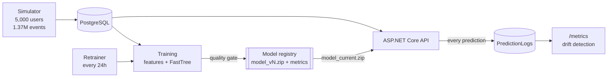

# Churn Prediction Pipeline


An end-to-end machine learning pipeline that predicts which users are likely to stop using a website within the next 30 days, built entirely in **.NET 10** with **ML.NET**, **PostgreSQL** and **Docker**.

The goal of the project is not just a model, but everything around it that a model needs to survive in production: reproducible data, leakage-safe features, an evaluation baseline, a model registry with a quality gate, a prediction API, scheduled retraining, prediction logging and drift monitoring.

```powershell
docker compose up --build
```

One command generates the data, trains the model and starts the API.

---

## Architecture



| Service | Role |
|---|---|
| `db` | PostgreSQL 17 |
| `simulator` | Applies migrations and generates reproducible user activity (seed 42), then exits |
| `training` | Builds the dataset, trains, evaluates and registers a model, then exits |
| `api` | Serves predictions, logs them, and reports model health |
| `retrainer` | Re-runs the training pipeline on a schedule |

Services start in order using `depends_on` with `service_healthy` and `service_completed_successfully`.

---

## Quick start

Requirements: Docker Desktop.

```powershell
git clone https://github.com/pauline8712/churn-prediction-pipeline.git
cd churn-prediction-pipeline
docker compose up --build
```

The first run takes a few minutes (the simulator writes 1.37 million events). When the API logs `Now listening`, try:

| Endpoint | Description |
|---|---|
| `GET http://localhost:5080/users/at-risk?top=20` | Users most likely to churn right now |
| `GET http://localhost:5080/users/{id}/churn-risk` | Churn risk for one user, with the main signals behind it |
| `GET http://localhost:5080/metrics?hours=24` | Prediction stats and feature drift compared with training |
| `GET http://localhost:5080/model` | Metadata of the model currently in use |
| `GET http://localhost:5080/health` | Health check |

Stop everything with `docker compose down` (data and models are kept in volumes).

---

## How it works

### 1. Data
There is no real website behind this project, so a simulator generates realistic behaviour for 5,000 users over 180 days. Each user gets a hidden persona:

| Persona | Share | Behaviour |
|---|---|---|
| Active | 60% | Visits about 4 days a week throughout |
| Declining | 25% | Activity slowly fades over time |
| Churning | 15% | Fades over 30 days, then stops completely |

The persona is **never stored in the database**. The model only sees what a real website would have: signup dates and events.

### 2. Features and labels
For a given **cutoff date**, features are computed only from events **before** the cutoff, and the label is whether the user had **no activity in the 30 days after** it.

| Feature | Signal |
|---|---|
| `DaysSinceLastEvent` | How long the user has been away |
| `SessionsLast7Days` / `SessionsLast30Days` | Current activity level |
| `ActivityTrend` | Last 7 days vs the 7 days before (negative = slowing down) |
| `PurchasesLast30Days` | Engagement |
| `PageViewsPerSession` | Depth of engagement |
| `AccountAgeDays` | New vs established users |

Seven cutoffs, 14 days apart, give **29,391 training rows** (3.5% churn). Only users who were active in the 30 days before a cutoff are included: users who already left cannot be saved, and including them would make the task artificially easy.

The same `FeatureCalculator` is used by both training and the API, which prevents **train/serve skew**.

### 3. Training and evaluation
- **Time-based split**: older cutoffs for training (19,901 rows), the two newest for testing (9,490 rows). A random split would let the model see the future.
- **Baseline**: a simple rule, *"inactive for more than 7 days means churn"*. The model must beat it to be worth using.
- **Model**: ML.NET FastTree (gradient-boosted decision trees).

### 4. Model registry and quality gate
Every training run is saved as `model_vN.zip` with a `model_vN.json` containing its metrics and feature baseline. A new model only becomes `model_current` if its AUC is **higher** than the current one. The API watches `model_current.zip` and reloads it without a restart.

### 5. Monitoring
Every prediction is logged together with the exact features the model saw. `/metrics` compares the mean of each feature in production with its mean in the training data, measured in training standard deviations:

| Drift score | Status |
|---|---|
| < 0.5 | OK |
| 0.5 – 1.0 | Warning |
| ≥ 1.0 | Drift |

---

## Results

Test set: 9,490 rows, 483 churned (5.1%).

| | Precision | Recall | F1 | AUC |
|---|---|---|---|---|
| Baseline (inactive > 7 days) | 54.2% | **72.9%** | 0.622 | – |
| FastTree, threshold 0.5 | **72.9%** | 64.0% | **0.681** | **0.953** |
| FastTree, threshold 0.4 *(chosen)* | 70.9% | 65.4% | 0.680 | 0.953 |

**Threshold choice.** With only 3.5% churners, accuracy is meaningless (always answering "stays" gives 96.5%). I compared thresholds from 0.1 to 0.5 and chose **0.4**: almost the best F1, while catching more churners than 0.5. Where to put the threshold is ultimately a business decision: a cheap action (an email) justifies a lower threshold than an expensive one (a phone call).

---

## Observations

These are the things I learned from the results, not just the numbers.

- **The model beats the baseline, but not by a huge margin.** At threshold 0.1 the model behaves almost exactly like the baseline rule. The simulator is fairly simple, churners just stop coming, so `DaysSinceLastEvent` carries most of the signal. On real, messier data the gap between a rule and a model is usually larger.
- **The top of the at-risk list is dominated by users who are already gone** (2–4 weeks inactive, zero sessions last week). They are easy to detect but hard to win back. The most valuable users to act on are probably the medium-risk ones who are still active but slowing down.
- **`AccountAgeDays` drifts by design** (score 3.25). Accounts were ~54 days old at training time and ~135 days old in "production", simply because time passes. Decision trees cannot extrapolate, so every account older than what the model has seen is treated the same. This feature should be removed or redesigned.
- **Monitoring caught real behaviour drift.** `DaysSinceLastEvent` doubled (1.7 → 3.5 days, *Warning*) and sessions dropped. Nobody changed the code; the user base had become less active as the declining users faded. This is exactly the kind of silent degradation monitoring is meant to catch.
- **The pipeline is reproducible.** Running locally on Windows and in Linux containers produced identical data, identical predictions and the same metrics (AUC differed only in the 6th decimal due to floating-point differences between platforms).

---

## Design decisions

| Decision | Why |
|---|---|
| All UTC timestamps | No daylight-saving bugs; servers in any timezone agree |
| Persona not in the database | Prevents label leakage |
| Composite index `(UserId, TimestampUtc)` | Feature queries fetch one user's events in a time range |
| Unit test proving no leakage | Events after the cutoff must not change any feature |
| Configuration via environment variables | Same code runs locally and in Docker |
| `PredictionLogs` has no foreign key to `Users` | Logs must survive even if users are deleted or re-simulated |
| Fixed seed and fixed dates | Every run produces exactly the same data and model |

---

## Project structure

```
src/
├─ Churn.Core        Entities, FeatureCalculator, shared records (no dependencies)
├─ Churn.Data        EF Core DbContext and migrations (PostgreSQL)
├─ Churn.Simulator   Generates users and events
├─ Churn.Training    Dataset, training, evaluation, registry, scheduled retraining
└─ Churn.Api         Prediction endpoints, logging and monitoring
tests/
└─ Churn.Tests       FeatureCalculator tests, including leakage and edge cases
```

CI (GitHub Actions) builds the solution, runs the tests and builds all Docker images on every pull request.

---

## Tech stack

.NET 10 · C# · ASP.NET Core Minimal APIs · ML.NET (FastTree) · Entity Framework Core · PostgreSQL 17 · Docker Compose · GitHub Actions · xUnit

---

## Next steps

- Remove or redesign `AccountAgeDays` (natural drift, no extrapolation)
- An endpoint for **medium-risk** users (40–70%), who are the most realistic to win back
- Explain individual predictions (feature contributions per user)
- Globally unique model ids (version numbers are only unique within one registry)
- Trigger retraining automatically when drift is detected, instead of only on a schedule
- A small dashboard (Blazor) on top of `/metrics`
- Replace the simulator with real event data from a website
